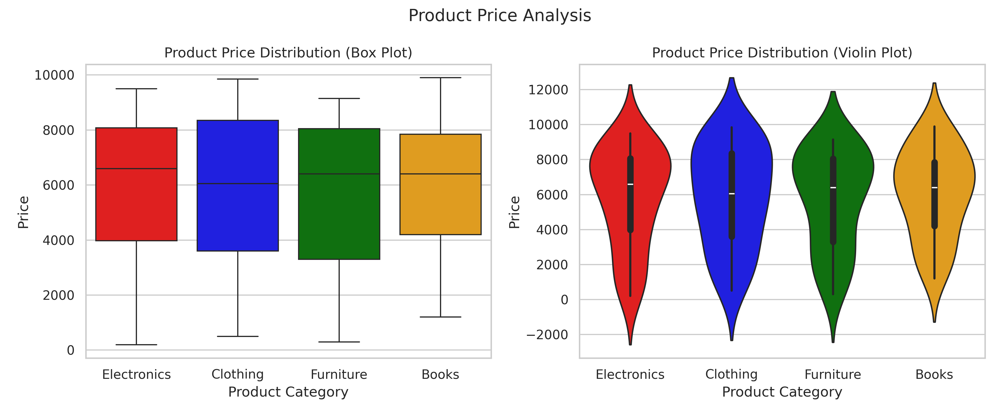

# 📊 Product Price Analysis Across Categories Using Python

## 📌 Project Overview

This project analyzes product prices across different categories using Python and data visualization techniques. It uses box plots and violin plots to understand the distribution of product prices.

## 🎯 Objectives

- Analyze product prices across different categories.
- Compare price distributions.
- Visualize data using box plots and violin plots.
- Understand price variations using statistical visualization.

## 🛠️ Technologies Used

- Python
- Pandas
- Matplotlib
- Seaborn
- Google Colab

## 📂 Project Structure

```text
Product-Price-Analysis/
│
├── Product_Price_Analysis.ipynb
├── products.csv
├── product_analysis.png
└── README.md
```

## 📊 Dataset Information

The dataset is stored in `products.csv`.

It contains the following columns:

| Column | Description |
|---|---|
| Product ID | Unique product identifier |
| Product Category | Product category |
| price | Product price |

The dataset contains four categories: Electronics, Clothing, Furniture and Books.

**Note:** The dataset contains synthetic sample data for educational and visualization purposes.

## ⚙️ Installation and Execution

1. Clone the repository:

```bash
git clone https://github.com/karanbagade236-sketch/Product-Price-Analysis.git
```

2. Navigate to the folder:

```bash
cd Product-Price-Analysis
```

3. Install the required libraries:

```bash
pip install pandas matplotlib seaborn
```

4. Open the notebook in Jupyter Notebook or Google Colab.

5. Ensure `products.csv` is available and run the notebook cells.

## 📈 Project Output

### Product Price Analysis



The output contains:
- Box Plot – Shows price distribution across product categories.
- Violin Plot – Shows the distribution and density of product prices.

## 💡 Key Learning Outcomes

- Reading CSV files using Pandas.
- Data analysis using Python.
- Creating box plots and violin plots.
- Understanding product price distributions.
- Saving visualizations as PNG images.

## 👨‍💻 Author

**Karan N B**

Computer Science and Engineering Student

## 📜 License

This project is intended for educational and learning purposes.
